# Informe: clasificación de especies de pingüinos con PCA, Bayes, LDA, QDA y SVM

**Materia:** Inferencia Estadística  
**Dataset elegido:** `db/penguins.csv` (Palmer Penguins)  
**Código:** [analisis_penguins.py](analisis_penguins.py)  
**Gráficos:** carpeta [graficos/](graficos/)  
**Resultados numéricos:** carpeta [resultados/](resultados/)

---

## 1. Objetivo

El objetivo es construir y comparar modelos que **predigan la especie de un pingüino** (Adelie, Chinstrap o Gentoo) a partir de cuatro medidas corporales. Para cada modelo se siguió el mismo proceso:

1. Eliminar los valores nulos.
2. Balancear las clases.
3. Entrenar el algoritmo.
4. Medir la _accuracy_ (proporción de aciertos).
5. Analizar la matriz de confusión y describir los errores.
6. Graficar la frontera de decisión.

Además se usa **PCA** para reducir la dimensión y visualizar los datos, y se analiza en detalle la **máquina de soporte vectorial (SVM)**.

---

## 2. Revisión de los algoritmos existentes en la carpeta

Antes de armar el análisis final se revisaron los notebooks que ya estaban en la carpeta:

| Archivo        | Qué hace                                                                  | Dataset                | Observaciones                                                                                                                                                                                                                                                     |
| -------------- | ------------------------------------------------------------------------- | ---------------------- | ----------------------------------------------------------------------------------------------------------------------------------------------------------------------------------------------------------------------------------------------------------------- |
| `bayes.py`     | Bayes ingenuo gaussiano, matriz de confusión, punto de corte manual y PCA | `water_potability.csv` | Entrena y evalúa con los mismos datos, lo que sobreestima la accuracy. La variable `nombres` no está definida, por lo que el gráfico PCA falla. Los comentarios hablan de "riesgo cardíaco" y de un corte de 0,7, pero el código usa 0,3. No balancea las clases. |
| `algoritmo.py` | PCA, comparación PCA vs SVD y Bayes ingenuo con frontera en 2 variables   | `Wine.csv`             | Está bien planteado. Hace PCA **sin estandarizar**, por lo que la variable _Proline_ (valores cercanos a 1000) domina el primer componente. Mezcla las rutas `Wine.csv` y `Datos/Wine.csv`.                                                                       |
| `adl_adc.py`   | LDA y QDA con validación cruzada                                          | Iris (de `sklearn`)    | Funciona (accuracy 0,98 con LDA y 0,973 con QDA), pero no usa ninguna base de `db/`. El archivo JSON está dañado, por lo que no abre como notebook.                                                                                                               |
| `lda_qda.py`   | Igual que el anterior, más una columna `resta`                            | Iris                   | Es una exportación de la vista JSON del navegador: no se puede ejecutar.                                                                                                                                                                                          |
| `bayes_2.py`   | —                                                                         | —                      | Archivo vacío.                                                                                                                                                                                                                                                    |

Este trabajo unifica todo en un solo script: corrige los problemas anteriores y aplica todos los algoritmos sobre el mismo dataset.

---

## 3. Revisión de las bases de datos y elección

| Base                     | Filas       | Tipo de problema                | Nulos            | Balance                       | ¿Apta?                                                                                                |
| ------------------------ | ----------- | ------------------------------- | ---------------- | ----------------------------- | ----------------------------------------------------------------------------------------------------- |
| `penguins.csv`           | 344         | 3 clases, 4 variables numéricas | Sí (19 celdas)   | Desbalanceada (Chinstrap 20%) | **Sí: la elegida**                                                                                    |
| `water_potability.csv`   | 3276        | 2 clases, 9 variables numéricas | Sí (1434 celdas) | 60% / 40%                     | Sí, pero las variables casi no separan las clases (Bayes ≈ 60% de accuracy, apenas mejor que el azar) |
| `Wine.csv`               | 178         | 3 clases, 13 variables          | No               | Casi balanceada               | Parcial: no permite practicar la limpieza de nulos ni el balanceo                                     |
| `train.csv` / `test.csv` | 7613 / 3263 | Texto (tweets de desastres)     | Sí               | 57% / 43%                     | No: requiere procesamiento de lenguaje natural y `test.csv` no tiene etiqueta                         |

**Por qué se eligió `penguins.csv`:** es la única base que cumple todos los requisitos del trabajo:

- Tiene **valores nulos reales** para limpiar.
- Tiene una **clase minoritaria** (Chinstrap) que justifica el balanceo.
- Sus variables son **numéricas y continuas**, que es lo que suponen Bayes gaussiano, LDA y QDA.
- Con 4 variables, el **PCA** se puede interpretar con facilidad.
- Las clases se separan razonablemente bien, así que las **fronteras de decisión** se pueden ver con claridad.

---

## 4. Paso a paso: cómo se procesa la base

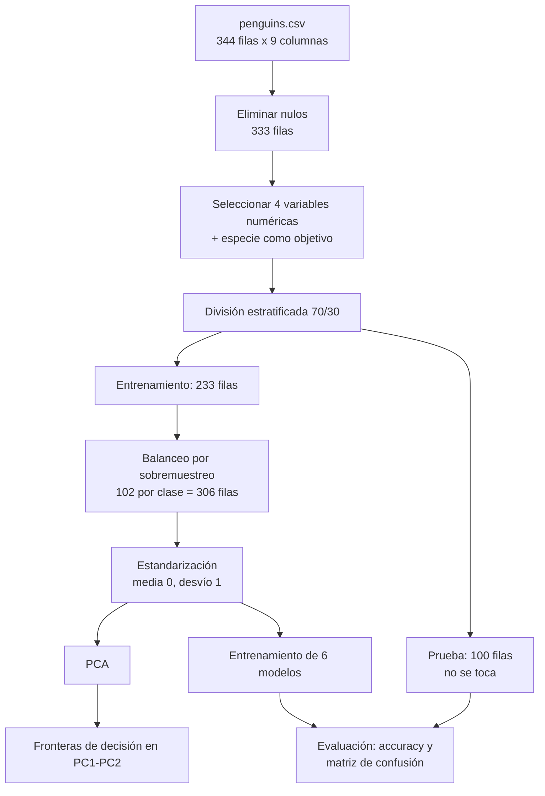

Registro generado por el script ([resultados/paso_a_paso.txt](resultados/paso_a_paso.txt)):

1. **Carga:** 344 filas x 9 columnas.
2. **Eliminación de nulos:** se quitan 11 filas (19 celdas vacías). Quedan **333 filas**.
3. **Selección de variables:**
   - Predictoras: largo del pico, profundidad del pico, largo de la aleta y masa corporal.
   - Objetivo: especie.
   - Se descartan `id` y `year` porque no aportan información biológica. También se descartan `island` (isla) y `sex`, para que la especie se prediga solo a partir de las medidas del cuerpo.
4. **Exploración:** histogramas, matriz de dispersión y correlaciones.
5. **División 70/30 estratificada:** 233 filas para entrenar y 100 para probar. "Estratificada" significa que las proporciones de cada especie se mantienen en ambos grupos.
6. **Balanceo:** el entrenamiento pasa de {Adelie 102, Chinstrap 48, Gentoo 83} a **102 de cada especie**. El conjunto de prueba **no se modifica**, para evaluar sobre datos reales.
7. **Estandarización:** cada variable pasa a tener media 0 y desvío 1. La media y el desvío se calculan solo con los datos de entrenamiento.
8. **PCA:** PC1 explica el 63,5% de la varianza y PC2 el 23,5% (87,1% entre las dos).
9. **Entrenamiento** de 6 modelos.
10. **Accuracy** en el conjunto de prueba y con validación cruzada.
11. **Matrices de confusión** y descripción de los errores.
12. **Interpretación interna** de cada modelo.
13. **Fronteras de decisión** en el plano PC1-PC2.
14. **Máquina de soporte vectorial:** caso multiclase y caso binario con margen.

> **Por qué el orden es importante:** el balanceo y la estandarización se hacen **después** de separar los datos y **solo sobre el entrenamiento**. Si se hicieran antes, copias de un mismo pingüino podrían quedar en entrenamiento y en prueba a la vez. El modelo "vería" datos de prueba durante el entrenamiento y la accuracy quedaría inflada artificialmente. Este problema se conoce como _data leakage_.

---

## 5. Limpieza y exploración de los datos

### 5.1 Valores nulos

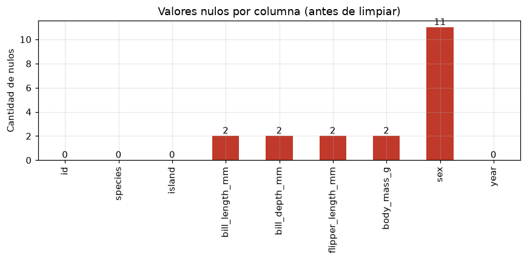

Hay 2 filas sin ninguna medida corporal y 11 filas sin el sexo registrado (algunas coinciden). Son pocas (3,2% del total), así que se eliminan las filas completas sin perder información relevante.

### 5.2 Distribución de las variables

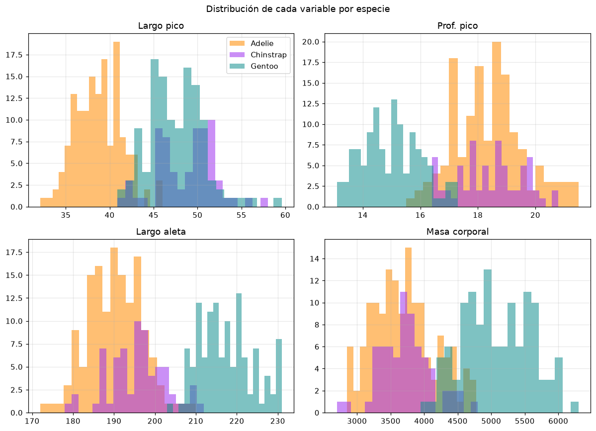

- **Gentoo** se diferencia con claridad: tiene la aleta más larga (≈217 mm), la mayor masa (≈5,1 kg) y el pico menos profundo (≈15 mm).
- **Adelie** y **Chinstrap** tienen aletas, masa y profundidad del pico muy parecidas. **Solo se diferencian bien por el largo del pico** (≈39 mm frente a ≈49 mm).

Por eso se espera que **casi todos los errores sean entre Adelie y Chinstrap**.

| Especie   | Largo pico (mm) | Prof. pico (mm) | Largo aleta (mm) | Masa (g) |
| --------- | --------------- | --------------- | ---------------- | -------- |
| Adelie    | 38,8            | 18,3            | 190,1            | 3706     |
| Chinstrap | 48,8            | 18,4            | 195,8            | 3733     |
| Gentoo    | 47,6            | 15,0            | 217,2            | 5092     |

### 5.3 Relación entre variables

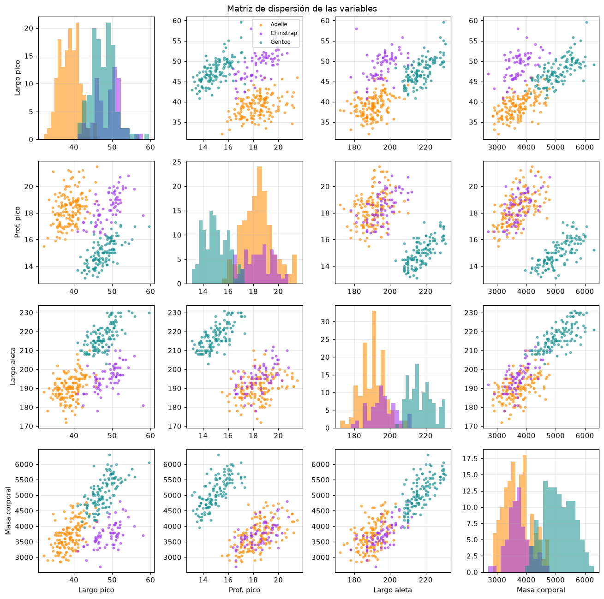

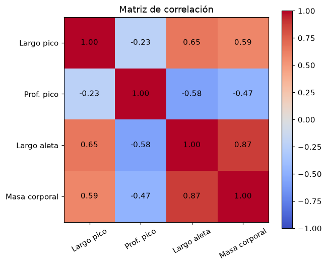

El largo de la aleta y la masa corporal están **muy correlacionados (r = 0,87)**. Este dato es importante para Bayes ingenuo (ver sección 7.1).

---

## 6. Balanceo de clases

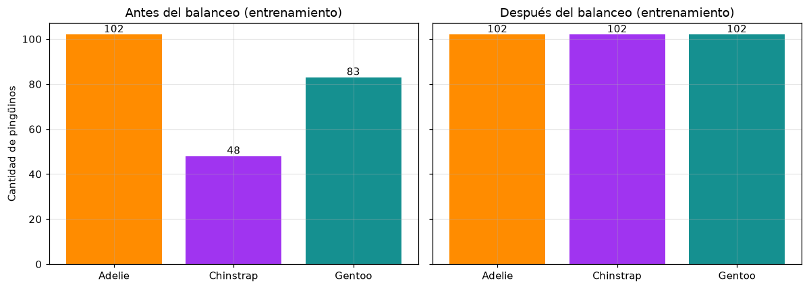

Chinstrap tiene menos de la mitad de ejemplos que Adelie. Si no se balancea, el modelo tiende a favorecer a las especies más frecuentes, porque equivocarse con Chinstrap "le cuesta" menos en la accuracy total.

Se aplicó **sobremuestreo aleatorio**: se duplican al azar ejemplos de las clases minoritarias hasta que todas tienen 102. Como consecuencia, las probabilidades a priori del modelo de Bayes quedan iguales para las tres especies (1/3 cada una).

---

## 7. Algoritmos utilizados

### 7.1 Bayes ingenuo gaussiano

Aplica el **teorema de Bayes**: elige la especie con mayor probabilidad dadas las medidas observadas.

$$P(\text{especie} \mid x) \propto P(\text{especie}) \cdot \prod_{i=1}^{4} P(x_i \mid \text{especie})$$

Se llama "ingenuo" porque **supone que las variables son independientes entre sí** dentro de cada especie. Por eso puede multiplicar las probabilidades de cada variable por separado. Cada $P(x_i \mid \text{especie})$ se modela con una campana de Gauss.

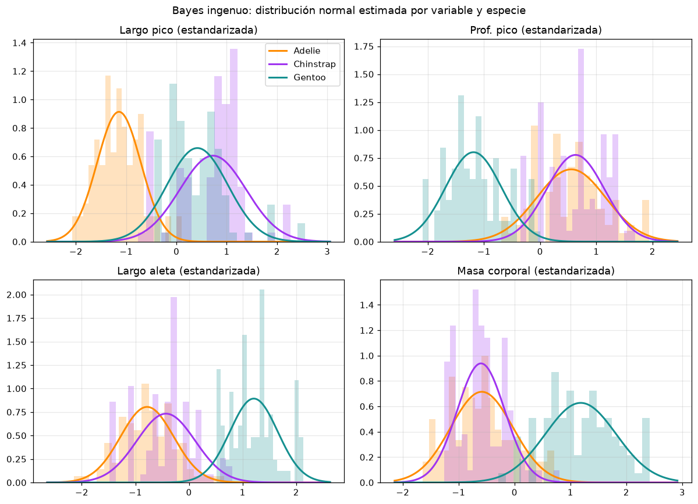

El gráfico muestra cómo "ve" los datos el modelo: una campana por variable y por especie. Donde las campanas de Adelie (naranja) y Chinstrap (violeta) se superponen, el modelo duda. Solo el largo del pico las separa con claridad.

**Limitación:** la independencia no se cumple, porque la aleta y la masa están correlacionadas (r = 0,87). Por eso se probó también **PCA + Bayes**: el PCA genera componentes no correlacionados entre sí, lo que acerca los datos a ese supuesto.

### 7.2 Análisis Discriminante Lineal (LDA)

También supone que cada especie sigue una distribución normal. A diferencia de Bayes ingenuo, **admite correlaciones entre variables**, con la condición de que todas las especies compartan la misma matriz de covarianza. Con ese supuesto, las fronteras resultan **rectas** (hiperplanos).

Además, LDA es una técnica de reducción de dimensión: busca los ejes que **mejor separan** las especies. PCA, en cambio, busca los ejes de mayor varianza, sin mirar las especies.

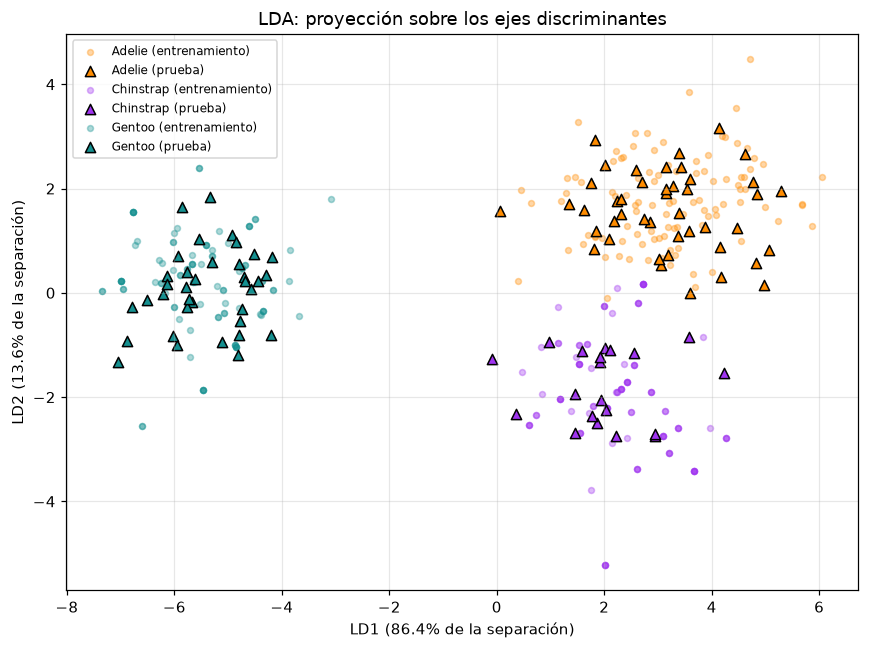

El primer eje discriminante (LD1) concentra el **86,4%** de la separación entre especies. En este espacio las tres especies aparecen claramente separadas.

### 7.3 Análisis Discriminante Cuadrático (QDA)

Es igual a LDA, pero permite que **cada especie tenga su propia matriz de covarianza**. Esto produce fronteras **curvas** (cuadráticas), más flexibles. A cambio, necesita estimar más parámetros.

### 7.4 Máquina de Soporte Vectorial (SVM)

No supone ninguna distribución para los datos. Busca la frontera que deja el **mayor margen posible** entre las clases. Los puntos que quedan sobre el borde del margen se llaman **vectores de soporte**: son los únicos que definen la frontera.

Se probaron dos versiones:

- **SVM lineal:** frontera recta.
- **SVM RBF:** usa un _kernel_ gaussiano que permite fronteras curvas.

Con tres especies, SVM entrena un clasificador por cada par de especies (enfoque _uno contra uno_) y luego combina sus resultados.

---

## 8. Resultados

### 8.1 Accuracy

La accuracy se midió de dos formas:

- **Prueba (30%):** 100 pingüinos que el modelo nunca vio.
- **Validación cruzada 5x3:** los datos se dividen 5 veces en entrenamiento y validación, y el proceso se repite 3 veces con distintas divisiones (15 evaluaciones en total). En cada división se vuelve a balancear y estandarizar. Es una medida **más confiable**, porque no depende de una sola división al azar.

| Modelo              | Accuracy prueba | Accuracy CV (media ± desvío) |
| ------------------- | --------------- | ---------------------------- |
| Bayes ingenuo       | 97,0%           | 96,5% ± 2,0%                 |
| PCA + Bayes ingenuo | 97,0%           | 97,7% ± 1,6%                 |
| **LDA**             | **100,0%**      | 98,7% ± 1,3%                 |
| **QDA**             | 99,0%           | **98,9% ± 1,0%**             |
| **SVM lineal**      | 98,0%           | 98,8% ± 1,4%                 |
| SVM RBF             | 98,0%           | 98,1% ± 1,4%                 |

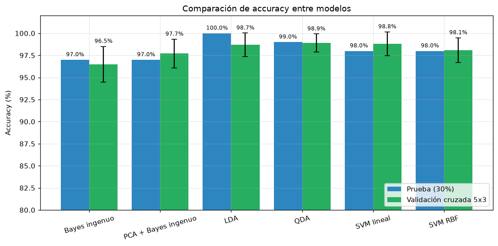

### 8.2 Matrices de confusión

En cada matriz, las **filas** son la especie real y las **columnas** la especie predicha. La diagonal muestra los aciertos y lo que queda fuera de ella son los errores.

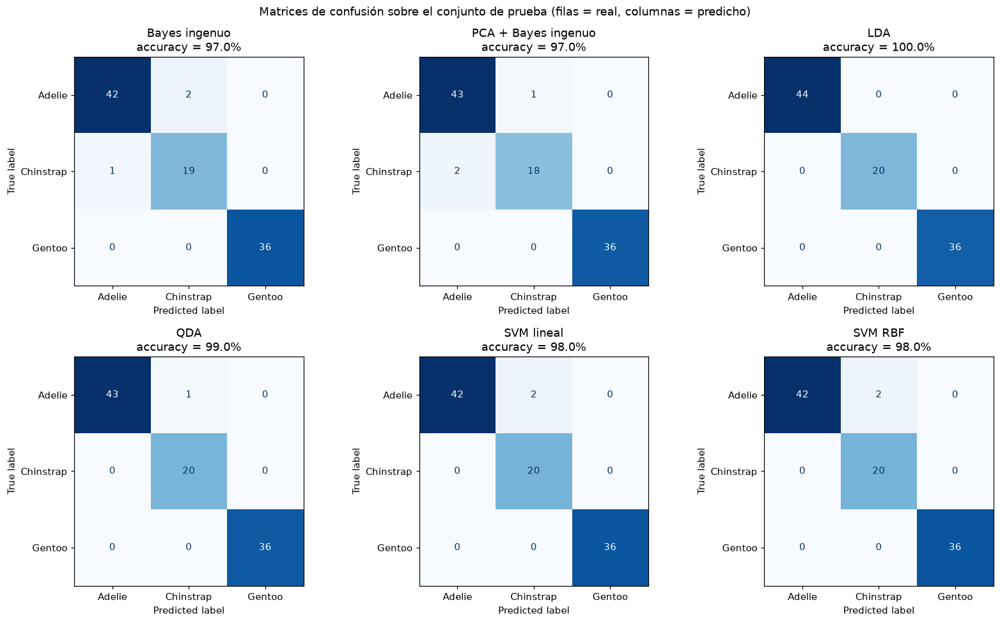

#### Detalle de los errores de cada algoritmo

El detalle completo, con precisión y _recall_ por especie, está en [resultados/errores_matriz_confusion.txt](resultados/errores_matriz_confusion.txt).

| Modelo              | Aciertos | Errores | Detalle                                                             |
| ------------------- | -------- | ------- | ------------------------------------------------------------------- |
| Bayes ingenuo       | 97/100   | 3       | 2 Adelie predichos como Chinstrap; 1 Chinstrap predicho como Adelie |
| PCA + Bayes ingenuo | 97/100   | 3       | 1 Adelie predicho como Chinstrap; 2 Chinstrap predichos como Adelie |
| LDA                 | 100/100  | 0       | Sin errores                                                         |
| QDA                 | 99/100   | 1       | 1 Adelie predicho como Chinstrap                                    |
| SVM lineal          | 98/100   | 2       | 2 Adelie predichos como Chinstrap                                   |
| SVM RBF             | 98/100   | 2       | 2 Adelie predichos como Chinstrap                                   |

**Análisis de los errores:**

- **Gentoo nunca se confunde.** Su precisión y su _recall_ son del 100% en todos los modelos, porque su tamaño corporal y la forma de su pico son muy distintos.
- **Todos los errores ocurren entre Adelie y Chinstrap**, como se anticipó en la exploración. Estas dos especies solo se distinguen por el largo del pico, y hay ejemplares de Adelie con el pico más largo de lo normal.
- **Efecto del balanceo:** en QDA y en los dos SVM, los errores van en una sola dirección: **Adelie → Chinstrap**. El _recall_ de Chinstrap es del 100%, es decir, todos los Chinstrap fueron reconocidos. Al balancear, la especie minoritaria gana peso. A cambio, algunos Adelie de frontera se clasifican como Chinstrap. Es el costo esperado de proteger a la clase minoritaria.
- **Bayes ingenuo** es el que más se equivoca, en ambas direcciones. Esto es coherente con que su supuesto de independencia no se cumple. Al aplicarle PCA antes, la accuracy en validación cruzada sube de 96,5% a 97,7%.
- **LDA tuvo 100% en prueba**, pero en validación cruzada obtiene 98,7%. Con solo 100 pingüinos de prueba, una diferencia de 1 o 2 aciertos puede deberse al azar de la división. Por eso, para comparar modelos conviene usar la validación cruzada.

---

## 9. Análisis de Componentes Principales (PCA)

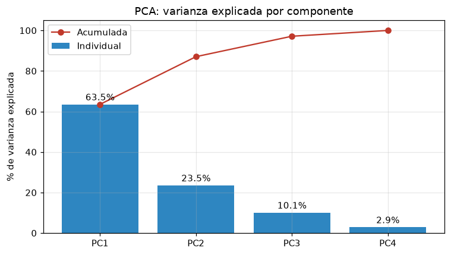

| Variable             | PC1       | PC2       |
| -------------------- | --------- | --------- |
| Largo del pico       | 0,350     | **0,795** |
| Profundidad del pico | -0,434    | **0,606** |
| Largo de la aleta    | **0,598** | 0,009     |
| Masa corporal        | **0,575** | -0,035    |

- **PC1 (63,5%)** representa el **"tamaño del cuerpo"**: crece con la aleta y la masa, y decrece con la profundidad del pico. Es el eje que **separa a Gentoo** del resto.
- **PC2 (23,5%)** representa la **"forma del pico"**: depende casi solo del largo y la profundidad del pico. Es el eje que **separa a Chinstrap de Adelie**.

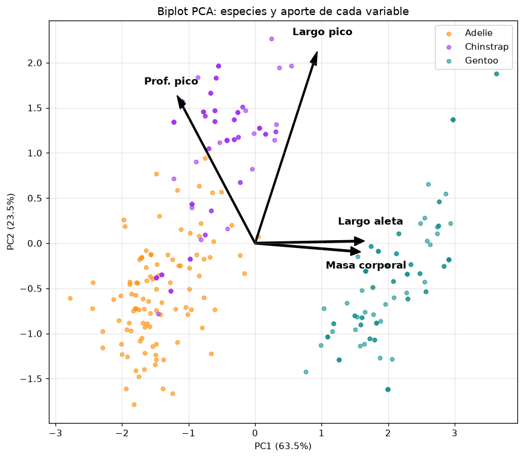

En el biplot, las flechas indican cuánto aporta cada variable original a cada componente. Las flechas de aleta y masa casi coinciden, lo que confirma su alta correlación.

---

## 10. Fronteras de decisión

Para poder dibujar las fronteras en un plano, cada modelo se reentrenó **usando solo PC1 y PC2**. En los gráficos, el color de fondo indica qué especie predice el modelo en cada zona, y los puntos son los pingüinos del conjunto de prueba.

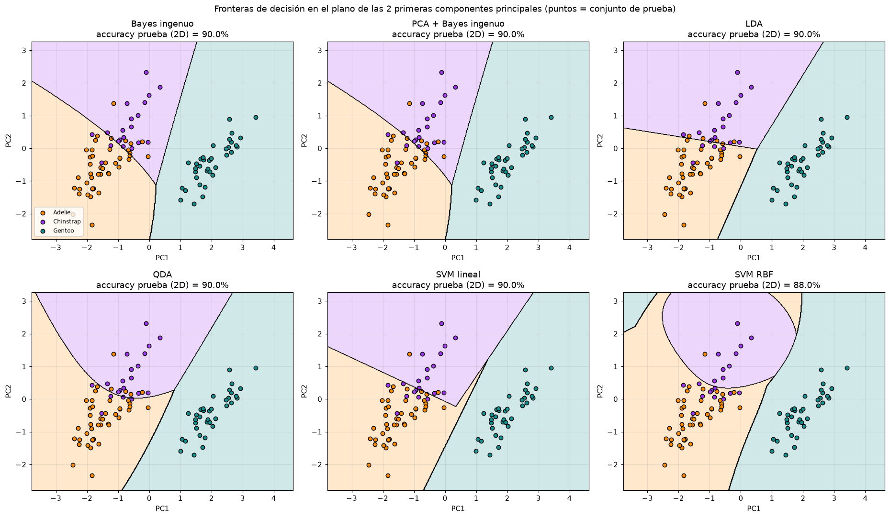

- **Bayes ingenuo y PCA + Bayes:** las fronteras son levemente curvas porque cada especie tiene su propia varianza. En 2 dimensiones dan el mismo resultado, ya que PC1 y PC2 no están correlacionados entre sí.
- **LDA y SVM lineal:** fronteras **rectas**.
- **QDA:** fronteras **parabólicas**. La zona de Chinstrap queda "encerrada" por una curva.
- **SVM RBF:** la frontera más flexible, con una zona de Chinstrap casi circular. Se ajusta más a los datos de entrenamiento, pero en este caso no generaliza mejor (88% en 2D).

**Observación importante:** con solo 2 componentes, todos los modelos bajan a ≈90% de accuracy, frente al 97-100% que logran con las 4 variables. Los componentes PC3 y PC4 explican apenas el 12,9% de la varianza, pero contienen información útil para separar Adelie de Chinstrap. Esto muestra que **PCA es una herramienta muy útil para visualizar, pero descartar componentes de poca varianza puede hacer perder información que sí sirve para clasificar**: PCA no tiene en cuenta las etiquetas cuando elige sus ejes.

---

## 11. Máquina de soporte vectorial en detalle

### 11.1 SVM multiclase

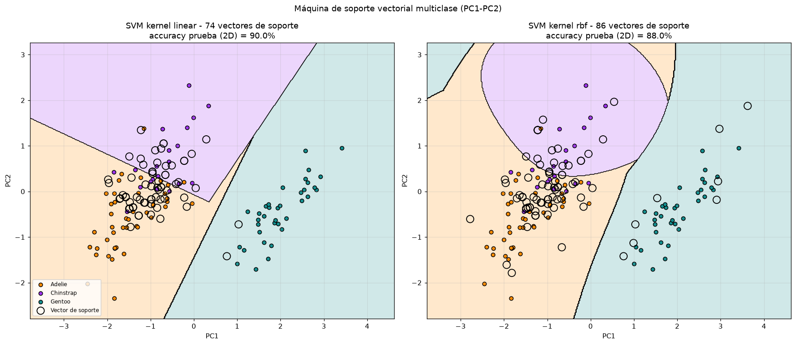

Los círculos negros marcan los **vectores de soporte**, que son los únicos puntos que determinan la frontera. En el modelo entrenado con las 4 variables:

| Kernel | Vectores de soporte (Adelie / Chinstrap / Gentoo) | Total     |
| ------ | ------------------------------------------------- | --------- |
| Lineal | 15 / 15 / 3                                       | 33 de 306 |
| RBF    | 26 / 23 / 8                                       | 57 de 306 |

Gentoo necesita muy pocos vectores de soporte porque está lejos de las otras especies. En cambio, Adelie y Chinstrap necesitan muchos, porque su zona de frontera está "poblada". El kernel RBF usa más vectores de soporte porque construye una frontera más compleja.

### 11.2 Caso binario: hiperplano y margen

Para mostrar visualmente el concepto de margen, se entrenó una SVM lineal solo con el par más difícil (**Adelie contra Chinstrap**), usando las dos variables del pico. En este caso el balanceo se hizo con `class_weight="balanced"`, que da más peso a los errores en la clase minoritaria. Se usó en lugar de duplicar ejemplos para que el gráfico no muestre puntos repetidos.

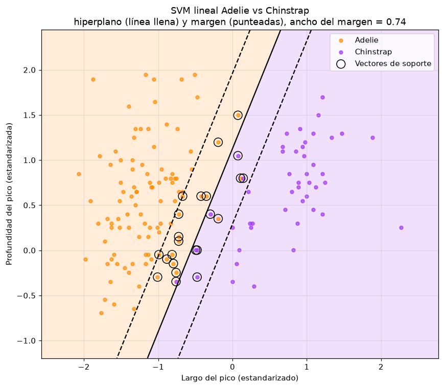

- **Línea llena:** el hiperplano, es decir, la frontera de decisión.
- **Líneas punteadas:** los bordes del margen.
- **Puntos con círculo:** los 23 vectores de soporte. Están sobre el margen o dentro de él.

Algunos puntos quedan del lado equivocado. Esto es posible porque se usó un **margen suave** (parámetro $C = 1$): se toleran algunos errores a cambio de una frontera más general, que no se adapte de más a los datos de entrenamiento.

---

## 12. Conclusiones

1. **Todos los algoritmos superan el 96% de accuracy.** Las medidas corporales alcanzan para identificar la especie de un pingüino.
2. **Los mejores modelos fueron QDA, SVM lineal y LDA** (≈98,8% en validación cruzada). Las diferencias entre ellos son menores que su desvío, así que en la práctica rinden igual. **LDA sería la opción recomendada:** es el más simple, sus fronteras son rectas y fáciles de interpretar, y no pierde precisión.
3. **Bayes ingenuo es el más débil (96,5%)**, porque supone independencia entre variables que están correlacionadas. Aplicar PCA antes mejora el resultado (97,7%).
4. **Gentoo se identifica sin errores.** Toda la dificultad está en distinguir **Adelie de Chinstrap**, que solo se diferencian por el largo del pico.
5. **El balanceo cumplió su objetivo:** ningún Chinstrap (la especie minoritaria) quedó sin detectar en los mejores modelos. El costo fue que unos pocos Adelie se clasificaron como Chinstrap.
6. **PCA resume bien los datos** (87% de la varianza en 2 componentes) y permite visualizar las fronteras. Sin embargo, para clasificar conviene usar todas las variables, porque los componentes "menores" contienen información que separa Adelie de Chinstrap.

---

## 13. Cómo reproducir los resultados

Desde la carpeta `todos/`, con el entorno virtual activado:

```bash
pip install numpy pandas matplotlib scikit-learn
python analisis_penguins.py
```

El script regenera todos los gráficos en `graficos/` y los archivos de `resultados/`:

- `paso_a_paso.txt`: registro de cada etapa del procesamiento.
- `metricas_accuracy.csv`: accuracy de prueba y de validación cruzada.
- `errores_matriz_confusion.txt`: errores y métricas por especie.
- `pca_cargas.csv`: cargas de cada variable en los componentes principales.
- `accuracy_fronteras_2d.csv`: accuracy de los modelos entrenados solo con PC1 y PC2.

El script también se puede ejecutar celda por celda en VS Code, porque está dividido con marcadores `# %%`.
